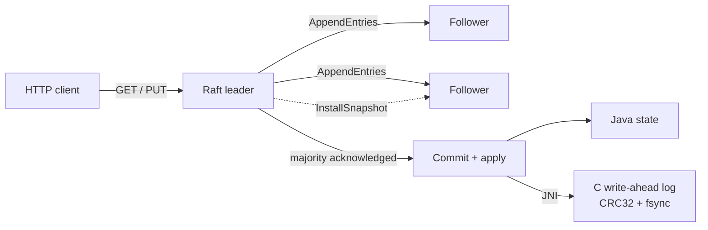

# RaftKV

[](https://github.com/EesherJ39/raft-kv/actions/workflows/ci.yml)

RaftKV is a three-node key-value store that stays consistent when servers crash or get cut off from each other.

I implemented the Raft consensus algorithm in Java without a library, and wrote the storage layer in C. To test it I built a deterministic fault simulator, a checker that verifies the history of reads and writes is linearizable, and a live trace viewer that shows elections and replication as they happen. There is a longer write-up at [eesherj.com/projects/raftkv](https://eesherj.com/projects/raftkv).

## Why I built it

Raft is the consensus algorithm behind etcd and Consul. The paper is readable, but the hard parts only show up when things go wrong: a leader that has been cut off from the others and does not know it yet, or a follower that restarts holding log entries nobody else has. I wanted to build it from scratch and then go after exactly those cases.

## Run it

### With Docker Compose

```bash
git clone https://github.com/EesherJ39/raft-kv.git
cd raft-kv
docker compose up --build -d
```

Open `http://localhost:8081` for the live trace viewer, then poke at the cluster:

```bash
curl http://localhost:8081/v1/status
curl http://localhost:8082/v1/status
curl http://localhost:8083/v1/status

# A follower returns 307; -L follows the redirect to the leader.
curl -i -L -X PUT --data 'world' http://localhost:8082/v1/kv/hello
curl -L http://localhost:8081/v1/kv/hello
```

### Without Docker

You need Java 17, Python 3.10+, CMake and a C11 compiler.

```bash
bash scripts/test.sh
bash scripts/build_all.sh
bash scripts/live_fault_test.sh
```

On Windows, `scripts/test.ps1` runs the protocol and checker tests. The native C build targets Linux and macOS.

## API

| Method | Path | What it does |
|---|---|---|
| `GET` | `/` | live Raft trace viewer |
| `GET` | `/healthz` | process liveness |
| `GET` | `/v1/status` | role, term, leader, and commit/apply/log/snapshot indexes |
| `GET` | `/v1/trace` | recent structured events (bounded) |
| `PUT` | `/v1/kv/{key}` | replicates and commits a UTF-8 value; `307` on a follower, `503` without a quorum |
| `GET` | `/v1/kv/{key}` | quorum-checked linearizable read; `307` on a follower |

Nodes talk to each other over a small versioned binary format with size limits. There is no reflection or Java object deserialization on that path.

## How it works



The Java side handles leader election, log replication, majority commits, quorum-checked reads, log repair and snapshots. A few of the decisions that mattered:

- **Reads check for a quorum.** A leader can be cut off from the others and still believe it is in charge. If it answered reads from memory it could hand out stale data. In RaftKV a leader only answers a read after it has committed an entry in its current term and heard back from a majority. A leader that cannot reach a majority refuses reads and writes.
- **Followers acknowledge only what matched.** A follower acknowledges the part of the log that matched the leader's request, and nothing it happened to have beyond that. When logs disagree, the follower sends back the conflicting term and index so the leader can jump to the right spot in one step.
- **Two kinds of storage.** Raft's own state (term, vote, log and snapshots) is written atomically to checksummed files. Committed commands also go through JNI into the C write-ahead log, which writes CRC32-checked records, calls fsync before updating its in-memory index, and repairs a torn tail on recovery. On recovery, the Raft state is the source of truth.
- **Easy to follow over fast.** One mutex protects all of the protocol state, and network calls happen outside it. Replication is synchronous and the full state is persisted each time. That keeps the code easy to reason about, and it is the main reason throughput is low.

The safety rules and storage format are written up in [`docs/DESIGN.md`](docs/DESIGN.md).

## How I tested it

`bash scripts/test.sh` runs all of the following. [`docs/TESTING.md`](docs/TESTING.md) describes each workload in detail.

- **Protocol tests: 8 of 8 pass.** They cover one vote per term surviving a restart, elections, quorum loss, overwriting a stale uncommitted suffix, overstated acknowledgements, installing a snapshot on a lagging follower, detecting corrupted state, and RPC encode/decode round trips.
- **Fault simulator: 1,000 seeded scenarios.** Each one mixes network partitions, crashed and restarted followers, an isolated old leader, a new election and duplicated messages, then heals the network and checks that every node ends up with the same data. Across all 1,000, 21,621 writes were committed, the simulated network blocked 36,992 RPCs and more than 17,000 messages were delivered twice. The duplicate count varies slightly with map iteration order, so that one is a lower bound.
- **Linearizability checker: 5 of 5 tests pass.** It searches for a legal order of the reads and writes that respects real time, one key at a time, and it correctly rejects a history containing a stale read.
- **Live cluster test.** `scripts/live_fault_test.sh` starts three real JVM processes on Linux, sends concurrent reads and writes, kills the leader and restarts it. In the run I recorded (WSL2, September 3, 2026), a new leader took over in **186 ms** and all 60 operations passed the linearizability check. That is a single run, so I do not treat 186 ms as a typical number.

## Limitations

This is a learning project, not a database to deploy. Membership is fixed at three nodes. Replication contacts followers one at a time, clients cannot safely retry a write because there is no request deduplication, and there is no TLS or authentication between nodes. It only supports PUT and GET. I have not run long soak tests or simulated disk failures either.

Next I would add client request deduplication, batch writes to disk so the whole state is not persisted each time, and replicate to followers in parallel. The full list is in [`docs/LIMITATIONS.md`](docs/LIMITATIONS.md).

## Repo map

| Path | What it does |
|---|---|
| `java/.../RaftNode.java` | the consensus state machine and replication |
| `java/.../FileRaftStorage.java` | atomic, checksummed storage for Raft state |
| `c/kvstore.c` | the C write-ahead log behind JNI, including torn-tail repair |
| `java/src/test/` | deterministic test cluster, protocol tests and the fault simulator |
| `python/linearizability.py` | the history checker |
| `scripts/live_fault_test.sh` | live three-process failover and recovery test |

## References

- Diego Ongaro and John Ousterhout, [*In Search of an Understandable Consensus Algorithm*](https://raft.github.io/raft.pdf)
- Martin Kleppmann, [*Designing a linearizability checker*](https://martin.kleppmann.com/2020/04/17/linearizability-checker.html)
